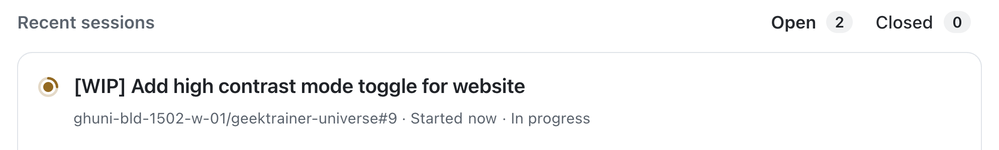

在前几节练习中，你让 Copilot 云智能体处理了三项改善用户体验和添加功能的任务。云智能体能够异步自主工作，但监控任务仍然很重要。

你可以使用多种工具管理分配给云智能体的任务，包括 GitHub.com 上的[智能体页面][agents-page]。在这个任务控制中心，可以查看所有带有未关闭拉取请求的智能体任务、检查其操作，也可以指导正在运行的会话。

本课将介绍：

- 使用智能体页面监控云智能体任务；
- 在会话运行过程中请求添加其他功能。

## 场景

分配高对比度模式任务后，团队决定同时添加浅色模式。既然正在更新网站样式并添加切换功能，就适合一并实现。你将指导智能体同时添加浅色和高对比度模式。

## 查看 Copilot 云智能体任务

1. 打开 [Copilot 智能体页面](https://github.com/copilot/agents)。
2. 查看主区域和左侧区域中的任务列表，确认已分配的任务，例如更新代码文档、生成游戏管理 API，以及为网站添加高对比度模式。
3. 选择一个正在运行的任务，检查 Copilot 已执行的操作，例如检出存储库、创建运行环境、设置 MCP 服务器，以及完成任务的其他步骤。

> [!NOTE]
> 根据 Copilot 的工作状态和解决问题的方式，具体列出的步骤可能不同。

4. 查看右侧显示的拉取请求区域，监控 PR 和更改的文件。

## 指导云智能体

现在让 Copilot 在实现高对比度模式时，也添加浅色模式切换开关：

1. 选择与高对比度模式相关的会话。确切标题取决于 Copilot 使用的名称和当前工作状态。

    

2. 观察会话几分钟，直到设置完成并开始工作。
3. 在 **Steer active session while Copilot is working** 对话框中输入以下提示：

    ```plaintext
    While we are working on a high contrast mode, let's also add a light mode. There should be a switch for this mode as well where users can select their desired display mode.
    ```

    

4. 按 <kbd>Enter</kbd> 发送提示。
5. 留意 Copilot 如何确认提示并将其加入工作流程。

## 让 Copilot 继续工作

Copilot 会在完成当前步骤后，将新增要求纳入任务。与之前一样，这需要几分钟；此时可以暂停一下，回顾已经学到的内容。

## 总结和后续步骤

本课介绍了 Copilot 智能体页面，它是监控和指导云智能体任务的中心位置。你可以跟踪所有正在运行和已完成的任务、查看工作内容，并调整进行中任务的范围或提供补充指导。

你已使用任务控制中心监控云智能体，并指导正在运行的会话添加功能。

Copilot 正在完成无障碍功能。接下来[迭代完善 Copilot 创建的拉取请求][next-lesson]。

## 资源

- [Copilot 智能体页面][agents-page]
- [关于自定义智能体][custom-agents]

---

| [← 上一课：自定义智能体][previous-lesson] | [下一课：迭代完善 Copilot 的工作 →][next-lesson] |
|:--|--:|

[previous-lesson]: ../3-custom-agents/
[next-lesson]: ../5-iterating/
[agents-page]: https://github.blog/changelog/2025-07-03-agents-page-for-copilot-coding-agent-in-public-preview
[custom-agents]: https://docs.github.com/copilot/concepts/agents/cloud-agent/about-custom-agents
