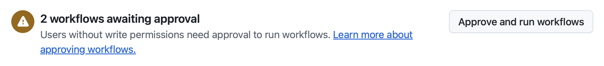

[← 上一课：管理智能体][previous-lesson]

## 审查工作

在本实验中，你与 GitHub Copilot 协作完成了若干改善用户体验和添加功能的任务：为代码添加文档、实现相关游戏功能，以及添加高对比度和浅色模式切换。现在审查代码更改，并在需要时向 Copilot 提供反馈。

### 场景

使用生成式 AI 并不会改变软件设计和 DevOps 的基本原则。始终需要审查生成的代码，并遵循正常的 DevOps 流程。接下来先审查 Copilot 生成的文档、相关游戏功能和无障碍功能，再为团队启用代码审查。

## GitHub Copilot 云智能体的安全性

云智能体异步且自主地执行任务，因此设有安全限制：

- Copilot 对存储库只有读取权限，对自身工作分支才有写入权限。
- 云智能体在 GitHub Actions 中运行，并创建独立、临时的工作环境。
- 任何 GitHub Actions 工作流都必须先获得人工批准才能运行。
- 默认情况下，[对外部资源的访问受到限制](https://docs.github.com/copilot/how-tos/copilot-on-github/customize-copilot/customize-cloud-agent/customize-the-agent-firewall)，包括 MCP 服务器。

## 审查生成的文档

先通过 GitHub.com 的常规 PR 界面，查看 Copilot 云智能体创建的第一个拉取请求：为代码添加文档。

> [!NOTE]
> PR 中可能会出现 GitHub Copilot 被防火墙阻止的警告。这是预期行为，因为 Copilot 默认只能有限访问外部资源，包括外部 MCP 服务器。你可以[自定义或禁用云智能体防火墙][agent-firewall]。

1. 在 github.com 上打开存储库。
2. 选择 **Pull Requests** 选项卡。
3. 打开标题类似 **Add missing documentation** 的拉取请求。

> [!NOTE]
> 如果 Copilot 仍在处理任务，拉取请求标题会带有 **[WIP]** 标记。请等待 Copilot 完成；这可能需要几分钟。

4. 选择 **Files changed** 选项卡并审查更改。

    

5. 查看新添加的 TSDoc 文档注释和其他文档。具体更改会有所不同。检查 TSDoc、TypeScript 约定和文件注释头，它们来自练习 2 中查看的自定义说明文件。
6. 确认更改后，返回 **Conversation** 选项卡并向下滚动。
7. 查看是否有等待批准的工作流。
8. 如果有，选择 **Approve and run workflows**。

   

9. 工作流会在 PR 的检查区域中排队运行。对于单个 Astro 应用，项目检查应当通过；此过程可能需要几分钟。

## 请求 GitHub Copilot 修改

你可以像在 PR 中评论团队成员一样，使用评论或代码行内评论提及 Copilot。Copilot 会读取评论并启动新会话来处理反馈。由于结果具有非确定性，无法规定固定提示词；可以要求 Copilot：

- 在每个代码文件顶部添加简要说明用途的注释头；
- 为 TypeScript 和 Astro 文件添加 TSDoc 文档注释；
- 创建介绍 Astro 应用结构的 README。

1. 添加评论并提及 **@copilot**，请求更新生成的文档。可以使用上面的建议，也可以提出其他改进要求。
2. 选择 **View Session**，观察 Copilot 启动新会话并更新内容。
3. 选择 **Back to pull request** 返回 PR。

    

4. Copilot 完成更改后，PR 中会出现新的提交。
5. 选择 **Files changed** 选项卡，审查更改。可以继续迭代，直到满意为止，然后将 PR 从草稿状态改为可审查并合并。


## 审查相关游戏功能

返回 Copilot 为“在游戏详情页显示相关游戏”议题创建的 PR：

1. 在 GitHub.com 上打开存储库并选择 **Pull Requests** 选项卡。
2. 打开标题类似 **Show related games on the game details page** 的 PR。
3. 选择 **Files changed** 并审查生成的代码。
4. 返回 **Conversation** 选项卡，查看并批准等待运行的工作流（如果有），再确认项目检查通过。
5. **可选：**在 codespace 中手动测试功能。打开终端，将 `<branch-name>` 替换为 Copilot 创建的分支名称（例如 **copilot/fix-8**），然后运行：

    ```bash
    git fetch origin
    git checkout <branch-name>
    ```

Copilot 已创建相关游戏功能。你还可以在 **Conversation** 选项卡添加评论，请求调整显示数量，或补充文件注释头和 TSDoc 文档注释。注意：分配这个任务时，你还没有更新自定义说明。

## 审查无障碍功能

最后，审查使用无障碍访问自定义智能体实现的功能。PR 应同时包含练习 3 中要求的高对比度模式，以及练习 4 中补充的浅色模式。

1. 在 GitHub.com 上打开存储库并选择 **Pull Requests** 选项卡。
2. 打开标题类似 **Add high contrast mode to website** 的 PR。
3. 如果 PR 仍带有 **[WIP]** 标记，请等待 Copilot 完成。
4. 选择 **Files changed**，重点检查：
   - 用于切换模式的 UI 组件；
   - 使用本地存储保存用户偏好；
   - 高对比度和浅色模式的 CSS 或样式更改；
   - ARIA 标签、键盘导航等无障碍属性；
   - 管理模式切换的 JavaScript/TypeScript 代码。
5. 返回 **Conversation** 选项卡，检查并批准等待运行的工作流（如果有），再确认项目检查通过。
6. **可选：**在 codespace 中切换到 Copilot 创建的分支并手动测试。运行上面的 `git fetch` 和 `git checkout` 命令，然后启动应用，在浏览器中测试高对比度和浅色模式开关，并确认重新加载页面后偏好仍然有效。

无障碍访问智能体帮助 Copilot 遵循无障碍最佳实践。如果发现问题，可以像之前一样在评论中提及 **@copilot**，请求它更新。

## 可选练习 — 继续委派任务

云智能体适合处理实际待办事项，让你专注于其他工作。可以在存储库中创建更多议题并分配给 Copilot，例如：

- 在游戏详情页创建支持者兴趣表单；
- 为游戏列表页添加分页；
- 为数据访问 helper 添加输入验证和错误处理。

## 总结

你已完成云智能体工作流，并且：

- **检查了存储库自带的自定义说明文件**，了解它们如何影响云智能体的输出；
- **向 Copilot 云智能体分配议题**，观察它设置环境、制定计划并异步执行；
- **创建并使用自定义智能体**，为无障碍访问添加高对比度和浅色模式切换；
- **使用 Copilot 智能体页面作为任务控制中心**，监控并指导运行中的会话；
- **审查并迭代完善云智能体创建的拉取请求**，通过提及 `@copilot` 请求更改并批准工作流。

## 回顾和后续步骤

你已完成云智能体工作流。其他工作流可以帮助你继续探索：

- 🖥️ **[VS Code 工作流](../../vscode/)** — 在 IDE 中使用 Copilot Chat 智能体模式和 MCP 集成。
- 💻 **[CLI 工作流](../../cli/)** — 在终端中交付两项经过审查的更改，体验 Plan 和 Autopilot 模式、智能体技能、自定义 QA 智能体、Playwright MCP、Agent Merge，以及可选的 `/delegate` 云智能体连接。

在自己的存储库中，还可以尝试：

- 将重构或测试覆盖率议题分配给云智能体；
- 为其他领域创建自定义智能体；
- 为其他技术栈设置 `copilot-setup-steps.yml`。

## 资源

- [GitHub Copilot][github-copilot]
- [关于 Copilot 智能体][copilot-agents]
- [将 GitHub 议题分配给 Copilot][assign-issue]
- [Copilot 云智能体设置工作流最佳实践][cloud-agent-best-practices]
- [配置 Copilot 云智能体防火墙][agent-firewall]

---

| [← 上一课：管理智能体][previous-lesson] |
|:--|

[github-copilot]: https://github.com/features/copilot
[cloud-agent-overview]: https://docs.github.com/copilot/concepts/agents/cloud-agent/about-cloud-agent
[assign-issue]: https://docs.github.com/copilot/how-tos/use-copilot-agents/cloud-agent/start-copilot-sessions
[setup-workflow]: https://docs.github.com/copilot/how-tos/copilot-on-github/customize-copilot/customize-cloud-agent/customize-the-agent-environment
[copilot-agents]: https://docs.github.com/copilot/concepts/agents/cloud-agent/about-cloud-agent
[cloud-agent-best-practices]: https://docs.github.com/copilot/how-tos/copilot-on-github/customize-copilot/customize-cloud-agent/customize-the-agent-environment
[agent-firewall]: https://docs.github.com/copilot/how-tos/copilot-on-github/customize-copilot/customize-cloud-agent/customize-the-agent-firewall
[previous-lesson]: ../4-managing-agents/
